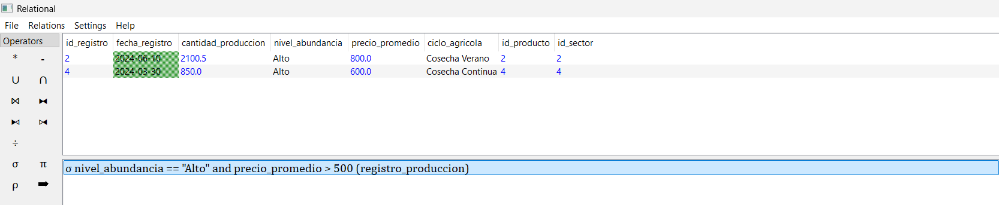
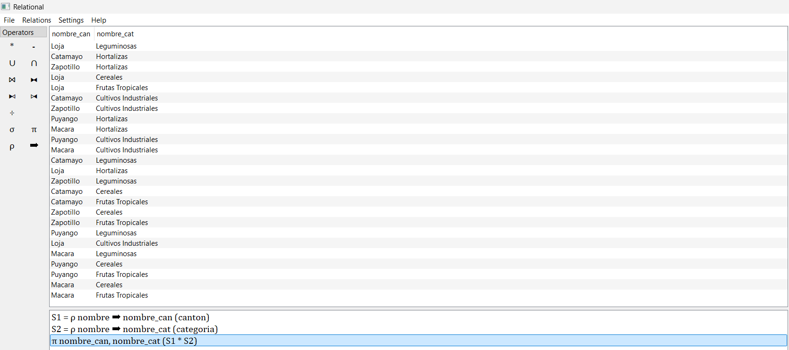
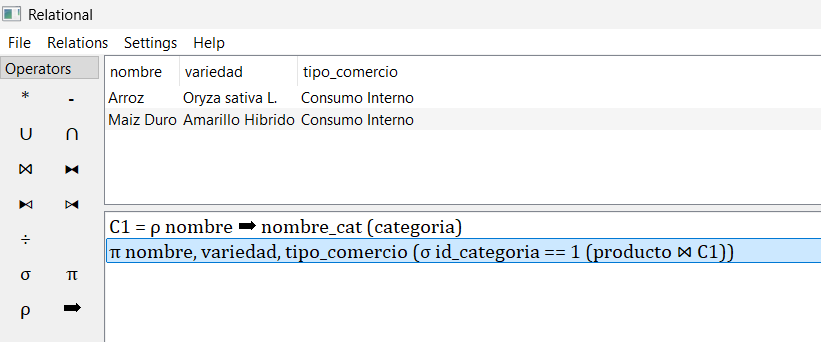
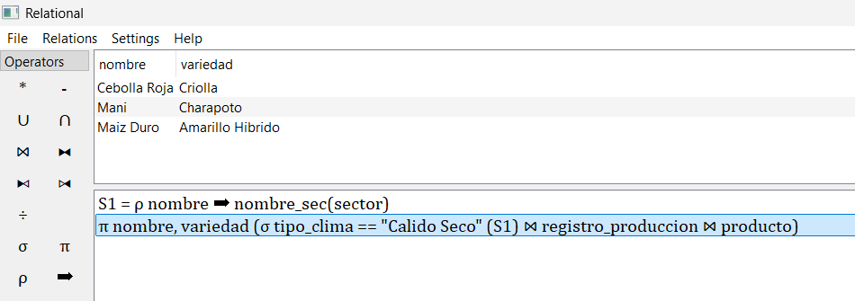
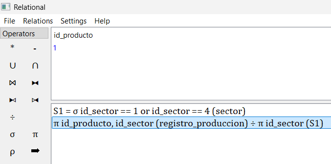

<p align="center">
  
</p>

<h1 align="center">INFORME DE FIN DE UNIDAD</h1>

<h2 align="center">
  Sistema de Inteligencia y Estadística Agrícola para la Provincia de Loja
</h2>

<p align="center">
  <strong>FEIRNNR - Carrera de Computación</strong>
</p>

---

## Datos Generales

| Información | Detalle |
|---|---|
| **Asignatura** | Base de Datos |
| **Ciclo** | 3 A |
| **Unidad** | 1 |
| **Docente** | Edwin René Guamán Quinche |
| **Estudiante** | Axel Joao Jiménez Palta |
| **Fecha** | 09/11/2026 |

### Resultado de aprendizaje de la unidad

Modelar bases de datos de problemas reales, bajo los principios de solidaridad, transparencia, responsabilidad y honestidad.

---

## Índice

1. [Título](#1-título)
2. [Contexto del problema](#2-contexto-del-problema)
3. [Objetivos](#3-objetivos)
4. [Modelos conceptuales de bases de datos](#4-modelos-conceptuales-de-bases-de-datos)
5. [Código SQL](#5-código-sql)
6. [Consultas de álgebra relacional y SQL](#6-consultas-de-álgebra-relacional-y-sql)
7. [Conclusiones](#7-conclusiones)
8. [Bibliografía](#8-bibliografía)

---

## 1. Título

**Sistema de Inteligencia y Estadística Agrícola para la Provincia de Loja**

## 2. Contexto del problema

La provincia de Loja cuenta con una importante actividad agrícola distribuida entre sus diferentes cantones y sectores. Sin embargo, la información relacionada con la producción de cultivos y los precios del mercado se encuentra dispersa y poco organizada. Esta situación dificulta relacionar las cantidades producidas con las variaciones de precios, lo que impide identificar con claridad si los aumentos responden a problemas de producción, condiciones climáticas, cambios en los períodos de cosecha o factores relacionados con la comercialización.
Esta problemática afecta tanto a los agricultores como a los consumidores y a las instituciones que necesitan información confiable para tomar decisiones. Los agricultores enfrentan dificultades para conocer el comportamiento del mercado, mientras que los consumidores se ven afectados por la inestabilidad de los precios. Asimismo, la falta de información organizada sobre los cantones, sectores, tipos de cultivos, períodos de cosecha y volúmenes de producción dificulta el análisis de la actividad agrícola y la identificación de posibles problemas de abastecimiento en la provincia de Loja.


## 3. Objetivos

### 3.1. Objetivo General

Diseñar e implementar una base de datos relacional para gestionar la información estadística y productiva del sector agrícola de la provincia de Loja, mediante el modelado lógico y físico, con la finalidad de analizar la disponibilidad de alimentos y su impacto en la fluctuación de precios regionales.

### 3.2. Objetivos Específicos

- Elaborar el diagrama Entidad-Relación y el modelo relacional para estructurar la jerarquía territorial, los catálogos botánicos y los registros de producción agrícola, garantizando la normalización de los datos.
- Construir el esquema físico en SQL utilizando sentencias DDL para la creación de tablas con sus respectivas restricciones, y comandos DML para la inserción de datos que permitan ejecutar y validar consultas de álgebra relacional.

---

## 4. Modelos conceptuales de bases de datos

### 4.1. Modelo Entidad-Relación (E-R)

<p align="left">
  
</p>

<p style="text-align:center; font-size:12px;">Figura 1. Diagrama Entidad-Relacion del Sistema de Inteligencia y Estadística Agrícola Regional </p>

[Ver Diagrama Entidad-Relación en draw.io](https://app.diagrams.net/#G13HBIkJWYOhQfYAtQVE5QYrDr9T17xFt1#%7B%22pageId%22%3A%22YsC8HymE1Lbt-HbOpI8D%22%7D)

### 4.2. Modelo Relacional

### 4.2.1 Diagrama Relacional

<p align="left">
  
</p>

<p style="text-align:center; font-size:12px;">Figura 2. Diagrama Relacional del Sistema de Inteligencia y Estadística Agrícola Regional. </p>

[Ver Diagrama Relacional en draw.io](https://app.diagrams.net/#G13HBIkJWYOhQfYAtQVE5QYrDr9T17xFt1#%7B%22pageId%22%3A%22aridOOU2unH2YhFbUsur%22%7D)

#### 4.2.2. Tabla Categoría

| Atributo | Tipo de Dato | Tipo de Clave | Referencia (FK) |
|---|---|---|---|
| id_categoria | INT | **PK** | - |
| nombre | VARCHAR(100) | - | - |
| descripcion | VARCHAR(255) | - | - |
| tipo_comercio | VARCHAR(50) | - | - |

#### 4.2.3. Tabla Cantón

| Atributo | Tipo de Dato | Tipo de Clave | Referencia (FK) |
|---|---|---|---|
| id_canton | INT | **PK** | - |
| nombre | VARCHAR(100) | - | - |
| zona_provincial | VARCHAR(50) | - | - |

#### 4.2.4. Tabla Sector

| Atributo | Tipo de Dato | Tipo de Clave | Referencia (FK) |
|---|---|---|---|
| id_sector | INT | **PK** | - |
| nombre | VARCHAR(100) | - | - |
| tipo_clima | VARCHAR(50) | - | - |
| id_canton | INT | **FK** | CANTON(id_canton) |

#### 4.2.5. Tabla Producto

| Atributo | Tipo de Dato | Tipo de Clave | Referencia (FK) |
|---|---|---|---|
| id_producto | INT | **PK** | - |
| nombre | VARCHAR(100) | - | - |
| variedad | VARCHAR(100) | - | - |
| id_categoria | INT | **FK** | CATEGORIA(id_categoria) |

#### 4.2.6. Tabla Meses_Cosecha

| Atributo | Tipo de Dato | Tipo de Clave | Referencia (FK) |
|---|---|---|---|
| id_producto | INT | **PK / FK** | PRODUCTO(id_producto) |
| mes | VARCHAR(20) | **PK** | - |

#### 4.2.7. Tabla Registro_Produccion

| Atributo | Tipo de Dato | Tipo de Clave | Referencia (FK) |
|---|---|---|---|
| id_registro | INT | **PK** | - |
| fecha_registro | DATE | - | - |
| cantidad_produccion | DECIMAL(10,2) | - | - |
| nivel_abundancia | VARCHAR(50) | - | - |
| precio_promedio | DECIMAL(10,2) | - | - |
| ciclo_agricola | VARCHAR(50) | - | - |
| id_producto | INT | **FK** | PRODUCTO(id_producto) |
| id_sector | INT | **FK** | SECTOR(id_sector) |

---

## 5. Código SQL

### 5.1. Creación de Tablas (DDL)

#### Tabla Categoría

```sql
CREATE TABLE CATEGORIA (
    id_categoria  INT          NOT NULL AUTO_INCREMENT,
    nombre        VARCHAR(100) NOT NULL,
    descripcion   VARCHAR(255),
    tipo_comercio VARCHAR(50),
    PRIMARY KEY (id_categoria)
);

```

#### Tabla Cantón

```sql
CREATE TABLE CANTON (
    id_canton       INT          NOT NULL AUTO_INCREMENT,
    nombre          VARCHAR(100) NOT NULL,
    zona_provincial VARCHAR(50)  NOT NULL,
    PRIMARY KEY (id_canton)
);

```

#### Tabla Sector

```sql
CREATE TABLE SECTOR (
    id_sector  INT          NOT NULL AUTO_INCREMENT,
    nombre     VARCHAR(100) NOT NULL,
    tipo_clima VARCHAR(50)  NOT NULL,
    id_canton  INT          NOT NULL,
    PRIMARY KEY (id_sector),
    FOREIGN KEY (id_canton) REFERENCES CANTON(id_canton)
);

```

## 🗄️ Base de Datos

La base de datos fue desarrollada en MySQL Workbench y contiene las tablas, relaciones y registros correspondientes al proyecto.

### Archivos SQL

- [📥 Descargar base de datos completa](ProyectoU1_bd.sql)

### 5.2. Inserción de Datos (DML)

#### Inserción en la tabla Categoría

```sql
INSERT INTO CATEGORIA (nombre, descripcion, tipo_comercio) VALUES
    ('Cereales', 'Granos secos como maiz y arroz', 'Consumo Interno'),
    ('Cultivos Industriales', 'Productos para procesamiento como el cafe', 'Exportacion'),
    ('Hortalizas', 'Vegetales de ciclo corto', 'Consumo Interno'),
    ('Leguminosas', 'Granos en vaina como mani y frejol', 'Mixto'),
    ('Frutas Tropicales', 'Frutas de zonas calidas', 'Consumo Interno');

```

#### Inserción en la tabla Cantón

```sql
INSERT INTO CANTON (nombre, zona_provincial) VALUES
    ('Zapotillo', 'Fronteriza Sur'),
    ('Macara', 'Fronteriza Sur'),
    ('Puyango', 'Occidente'),
    ('Catamayo', 'Centro-Norte'),
    ('Loja', 'Centro');

```

#### Inserción en la tabla Sector

```sql
INSERT INTO SECTOR (nombre, tipo_clima, id_canton) VALUES
    ('Garza Real', 'Calido Seco', 1),        -- Pertenece a Zapotillo (1)
    ('Sabiango', 'Calido', 2),               -- Pertenece a Macará (2)
    ('Alamor', 'Templado', 3),               -- Pertenece a Puyango (3)
    ('Valle de Casanga', 'Calido Seco', 4),  -- Pertenece a Catamayo (4)
    ('Vilcabamba', 'Templado', 5);           -- Pertenece a Loja (5)

```

### Script Inserciones 

 [📥 Descargar script de inserción de datos](Inserts_ProyectoU1.sql)
 
---

### 5.3. Archivos CSV

Los datos utilizados en el proyecto se encuentran organizados en archivos CSV, correspondientes a las tablas de la base de datos.

| N.º | Tabla | Archivo CSV |
|---|---|---|
| 1 | Categoría | [Ver CSV](csv/CATEGORIA.csv) |
| 2 | Cantón | [Ver CSV](csv/CANTON.csv) |
| 3 | Sector | [Ver CSV](csv/SECTOR.csv) |
| 4 | Producto | [Ver CSV](csv/PRODUCTO.csv) |
| 5 | Meses de cosecha | [Ver CSV](csv/MES_COSECHA.csv) |
| 6 | Registro de producción | [Ver CSV](csv/REGISTRO_PRODUCCION.csv) |


## 6. Consultas de álgebra relacional y SQL

### 6.1. Ejercicio 1 — Selección (σ)

**Enunciado:** Se desea obtener el registro completo de todas las transacciones de producción agrícola que reporten un nivel de abundancia "Alto" y cuyo precio promedio de mercado sea superior a los 500 dólares por tonelada.

**Álgebra Relacional:**

```text
σ nivel_abundancia == "Alto" and precio_promedio > 500 (registro_produccion)
```

**Consulta SQL:**

```sql
SELECT *
 FROM REGISTRO_PRODUCCION 
WHERE nivel_abundancia = 'Alto' AND precio_promedio > 500;

```

**Resultado esperado:**

Se obtendrán los registros completos (todas sus columnas) correspondientes a las cosechas de Arroz en Macará y Cebolla en Catamayo, que son los únicos que cumplen ambas condiciones económicas y de volumen simultáneamente.

<h4>Resultado de la Consulta 1 — Selección</h4>

<p align="center">
  
</p>

---

### 6.2. Ejercicio 2 — Proyección (π) y Producto Cartesiano (×)

**Enunciado:** ¿Cómo se relacionan de forma cruzada los diferentes cantones de la provincia con cada una de las categorías de productos agrícolas, permitiendo explorar todas las combinaciones posibles de ubicación y tipo de cultivo?

**Álgebra Relacional:**

```text
S1 = ρ nombre ➡ nombre_can (canton)
S2 = ρ nombre ➡ nombre_cat (categoria)
π nombre_can, nombre_cat (S1 * S2)
```

**Consulta SQL:**

```sql
SELECT 
    S1.nombre AS nombre_can, 
    S2.nombre AS nombre_cat
FROM CANTON S1
CROSS JOIN CATEGORIA S2;
```

**Resultado esperado:**

Se proyectarán exactamente 25 pares de datos, mostrando columnas que relacionan cada ubicación geográfica con cada tipo de cultivo posible (ej. "Zapotillo – Frutas Tropicales").

<h4>Resultado de la Consulta 2 — Proyección</h4>

<p align="center">
  
</p>

---

### 6.3. Ejercicio 3 — Selección y Proyección (σ + π)

**Enunciado:** Se desea extraer exclusivamente los atributos descriptivos (nombre, variedad y tipo de comercio) de aquellos productos que pertenecen a la categoría de "Cereales" resolviendo la ambigüedad del atributo homónimo.

**Álgebra Relacional:**

```text
C1 = ρ nombre ➡ nombre_cat (categoria)
π nombre, variedad, tipo_comercio (σ id_categoria == 1 (producto ⋈ C1))
```

**Consulta SQL:**

```sql
SELECT P.nombre, P.variedad, C1.tipo_comercio
FROM PRODUCTO P
JOIN CATEGORIA C1 ON P.id_categoria = C1.id_categoria
WHERE P.id_categoria = 1;

```

**Resultado esperado:**

El conjunto de resultados filtrará las columnas de control y devolverá únicamente los tres atributos solicitados para las instancias que cumplan la condición lógica (Arroz y Maíz Duro).

<h4>Resultado de la Consulta 3 — Selección y Proyección</h4>

<p align="center">
  
</p>

---

### 6.4. Ejercicio 4 — Reunión Natural / JOIN (⋈)

**Enunciado:** Identificar qué productos agrícolas (nombre y variedad) se cultivan en las zonas geográficas tipificadas con un clima "Cálido Seco", cruzando las tablas de catálogo con los registros transaccionales y evitando la colisión de atributos descriptivos.

**Álgebra Relacional:**

```text
S1 = ρ nombre ➡ nombre_sec(sector)
π nombre, variedad (σ tipo_clima == "Calido Seco" (S1) ⋈ registro_produccion ⋈ producto)
```

**Consulta SQL:**

```sql
SELECT P.nombre, P.variedad 
FROM SECTOR S1
JOIN REGISTRO_PRODUCCION RP ON S1.id_sector = RP.id_sector
JOIN PRODUCTO P ON RP.id_producto = P.id_producto
WHERE S1.tipo_clima = 'Cálido Seco';

```

**Resultado esperado:**

Se resolverán las relaciones de claves foráneas para devolver únicamente los nombres de los cultivos sembrados en dicho microclima (el Maíz en Garza Real y la Cebolla en Casanga).

<h4>Resultado de la Consulta 4 — JOIN</h4>

<p align="center">
  
</p>

---

### 6.5. Ejercicio 5 — División (÷)

**Enunciado:** ¿Cuáles son los productos agrícolas que se han logrado cosechar y registrar en absolutamente todos los sectores disponibles en el Sistema?

**Álgebra Relacional:**

```text
S1 = σ id_sector == 1 or id_sector == 4 (sector)
π id_producto, id_sector (registro_produccion) ÷ π id_sector (S1)
```

**Consulta SQL:**

```sql
SELECT P.nombre, P.variedad
FROM PRODUCTO P
WHERE NOT EXISTS (
    SELECT S1.id_sector 
    FROM SECTOR S1
    WHERE (S1.id_sector = 1 OR S1.id_sector = 4)
      AND NOT EXISTS (
          SELECT RP.id_registro 
          FROM REGISTRO_PRODUCCION RP
          WHERE RP.id_producto = P.id_producto 
            AND RP.id_sector = S1.id_sector
      )
);

```

**Resultado esperado:**

Se proyectará el identificador del producto (id_producto = 1), correspondiente al Maíz Duro, validando matemáticamente que es el único cultivo registrado de manera simultánea en todos los sectores que componen la relación intermedia S1 (sectores 1 y 4).

<h4>Resultado de la Consulta 5 — División</h4>

<p align="center">
  
</p>

---

## 7. Conclusiones

* El proceso de modelado conceptual por medio del diagrama E-R y su transformación al modelo relacional, me permitió organizar de manera clara la información agrícola de la provincia de Loja, una de las principales dificultades fue identificar correctamente las relaciones y cardinalidades entre las entidades, especialmente al conectar los datos geo-gráficos con los productos agrícolas resolver este desafío me permitió reducir la redun-dancia de información y establecer una estructura adecuada para la base de datos.
* La implementación de la base de datos mediante SQL me permitió llevar a la práctica los conocimientos sobre normalizar e integrar datos. Durante este proceso se comprendí la importancia de definir correctamente los tipos de datos, las claves primarias y forá-neas, así como el orden de inserción de los registros, los errores encontrados durante la ejecución ayudaron a identificar problemas en la estructura y reforzar la importancia de mantener la consistencia de la información.
* El uso del álgebra relacional me permitió comprender mejor cómo se construyen las consultas antes de llevarlas a SQL. Al utilizar Relational, aplique operaciones de selec-ción, proyección, producto cartesiano, reunión natural, división y renombramiento. Las consultas que relacionaban varias tablas fueron muy útiles ya que me permitieron resol-ver ambigüedades entre atributos y obtener información relevante sobre la distribución y diversidad de cultivos en las distintas zonas agrícolas.

---

## 8. Bibliografía

[1] E. F. Codd, "A Relational Model of Data for Large Shared Data Banks," *Communications of the ACM*, vol. 13, no. 6, pp. 377-387, Jun. 1970.

[2] P. P. Chen, "The Entity-Relationship Model—Toward a Unified View of Data," *ACM Transactions on Database Systems*, vol. 1, no. 1, pp. 9-36, Mar. 1976.

[3] Instituto Nacional de Estadística y Censos (INEC), *Encuesta de Superficie y Producción Agropecuaria Continua (ESPAC) 2024*, Ecuador, abr. 2025.
